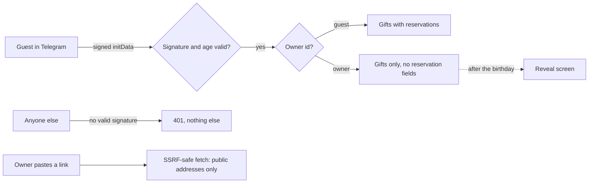

<a id="top"></a>
<div align="center">
  

  [](https://github.com/yinon-mitin/wishlist-bot/actions/workflows/validate.yml)
  [](LICENSE)
  [](Dockerfile)
  [](docker-compose.yml)
  [](https://core.telegram.org/bots/webapps)

  **Wishlist — a self-hosted Telegram mini-app for your birthday: friends reserve a gift or chip in together, and you stay surprised.**

  [Quick start](#quick-start) · [Features](#features) · [Security](#security-model) · [Architecture](docs/ARCHITECTURE.md) · [Install guide](docs/INSTALL.md)
</div>

## Overview

A wishlist shared in a chat has one flaw: the person it is for can see who is giving what. **Wishlist** fixes that. You share one link to your bot; friends and family open it inside Telegram, see your gifts, and reserve one (or chip in for a big one) so that nobody buys the same thing twice. Everyone but you can see who reserved what. **You see nothing** until the reveal after your birthday.

It runs on your own computer or a small server, in one Docker container with SQLite inside. There are no accounts to create: guests are recognised by Telegram, and the app makes no requests to third-party services from their phones.

> [!NOTE]
> The interface speaks Russian and English and follows each guest's Telegram language; anyone can switch it with the button in the corner.

## Features

| | |
| --- | --- |
| 🎁 **The surprise stays** | You never see reservations: not in the app, not in any server response, not in notifications. After your birthday a reveal screen shows who gave what, and you mark what you received. |
| 🤝 **Chip in together** | Turn on group funding for an expensive gift: guests add their share in the gift's currency, see a progress bar and the list of contributors, and can never go over the price. |
| 🔗 **Paste a link, get a gift** | Title, description, price and photo are read from the shop page (Open Graph and JSON-LD). Nothing you typed is overwritten without asking. Photos are re-encoded to WebP with metadata stripped. |
| 💱 **Prices in any currency** | A guest picks a currency and sees every price converted at today's rate next to the original. Rates refresh every 12 hours. |
| 🌍 **Russian and English** | Follows the Telegram language; switch with one tap; plural forms are correct (1 день, 2 дня, 5 дней). |
| 🎂 **A new round every year** | Close the round after the birthday: gifts you received leave the list, the rest stay on it with fresh, empty reservations, everyone who gave a received gift gets a thank-you message in their language, and next year's countdown starts. |
| ⭐ **Priorities, notes, drafts** | Mark gifts as most wanted, want or nice to have; add a note ("colour: grey"); keep a gift hidden as a draft until you publish it. |
| ⏳ **Countdown** | The home screen counts days to your birthday in your time zone. |
| 📤 **Share one gift** | A button opens Telegram's share dialog with a link that opens the app straight on that gift. The shared text is only the title. |
| 💾 **Nightly backup** | A consistent snapshot of the database arrives in your Telegram chat every night; old ones are pruned. |
| 📦 **One container** | Node, SQLite, a 30 KB (gzipped) web bundle, no external fonts, scripts or trackers. |

### What it looks like

```text
Guest opens your bot ─►  ┌─────────────────────────────┐
                         │  Wishlist                RU │
                         │  ┌───────────────────────┐  │
                         │  │ 63 days  until Mar 14 │  │
                         │  └───────────────────────┘  │
                         │  Most wanted                │
                         │  ■ Keychron Q1     Available│
                         │    $189 ≈ ₽17 010           │
                         │  ■ Headphones           56% │
                         │    ₽31 990 · chip in        │
                         │  [      All gifts · 17    ] │
                         └─────────────────────────────┘

You open it:  the same screens, plus “Add a gift”, and no names, no statuses, no percentages.
After the birthday:  Reveal → who gave what → mark received → Wrap up the round.
```

## Quick start

Requirements: Docker with Compose v2, Git and Make, and [Tailscale](https://tailscale.com) if you want to expose the app with Funnel (any HTTPS reverse proxy works too). On macOS, [OrbStack](https://orbstack.dev) or Docker Desktop.

```sh
git clone https://github.com/yinon-mitin/wishlist-bot.git
cd wishlist-bot
make init
```

Fill in the first block of `.env`: `BOT_TOKEN` from [@BotFather](https://t.me/BotFather), your numeric Telegram ID as `OWNER_ID`, `BIRTHDAY` as `MM-DD` and the public `PUBLIC_URL`. Then:

```sh
make test
make up
tailscale funnel --bg 8080
```

Open your bot in Telegram, press **Start** and then the menu button. The [install guide](docs/INSTALL.md) covers creating the bot, connecting the mini-app, Funnel, every setting and troubleshooting.

## Security model



- **Who is who.** Every request carries Telegram's signed `initData`; the server verifies the signature with the bot token and rejects stale data. The owner is the Telegram ID in `OWNER_ID`, nothing else.
- **The owner's blindness is enforced on the server.** Responses built for the owner never contain reservation or funding fields, enforced by tests that call every route, and by browser tests that also read the page and the network traffic. The only place reservations appear is the reveal screen, available on or after the birthday.
- **Links are fetched safely.** When you paste a shop link, the server resolves it, refuses private, loopback and link-local addresses (also after redirects), and caps size and time.
- **No third parties on the guest's phone.** The web bundle makes requests only to your own server; fonts are the system fonts.
- **Secrets stay out of Git.** `.env` and `data/` are ignored, and `make check` scans tracked files for bot tokens, keys and personal paths.

> [!WARNING]
> The blindness is a promise of the application, not cryptography. Whoever runs the server (you, in the typical case) can read the database, and the nightly backup file sent to your Telegram chat **contains the reservations**. If you want to be surprised, do not open the backup files and do not inspect the database before the birthday. See [Architecture](docs/ARCHITECTURE.md) and the [security policy](SECURITY.md).

## Operations

```text
make init       Create .env and data/ from the template
make check      Type check, docs and repository safety checks, Compose file
make test       make check + unit tests
make e2e        Browser journeys (Playwright, needs a Chromium)
make up         Build and start (or update) the app
make down       Stop the app
make restart    Restart the app
make ps         Container status
make logs       Follow the log
```

Updates, backups, restoring and rotating the bot token: [Operations](docs/OPERATIONS.md).

## Documentation

| Topic | Page |
| --- | --- |
| Creating the bot, Funnel, settings, first run | [Install](docs/INSTALL.md) |
| How it is built and which rules never break | [Architecture](docs/ARCHITECTURE.md) |
| Running, updating, backups, token rotation | [Operations](docs/OPERATIONS.md) |
| Reporting a vulnerability, operator duties | [Security](SECURITY.md) |
| Contributing | [Contributing](CONTRIBUTING.md) |
| Who made it | [Contributors](CONTRIBUTORS.md) |

## Credits and license

Licensed under the [Apache License 2.0](LICENSE); see [NOTICE](NOTICE).

Exchange rates come from the free [open.er-api.com](https://www.exchangerate-api.com) service ([Rates By Exchange Rate API](https://www.exchangerate-api.com)). The app talks to Telegram through [grammY](https://grammy.dev) and the [Telegram Web Apps SDK](https://github.com/twa-dev/sdk); the interface is built with [Preact](https://preactjs.com) and the server with [Hono](https://hono.dev) and [better-sqlite3](https://github.com/WiseLibs/better-sqlite3).

Maintained by [Yinon Mitin](https://github.com/yinon-mitin), with AI-assisted engineering and documentation; the participating model is listed in [CONTRIBUTORS.md](CONTRIBUTORS.md).
