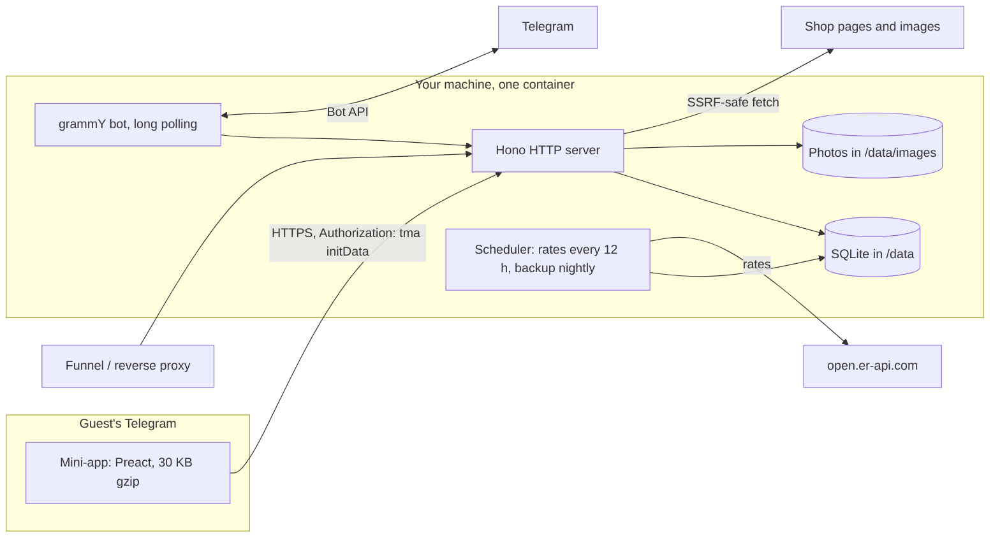

# Architecture

[Back to the README](../README.md)

## Parts

- **Server** (`src/server`): Hono routes under `/api`, the public `/images/*` for photos, the built mini-app for everything else, `/healthz`. SQLite through better-sqlite3 with versioned migrations. The bot runs in the same process using long polling, so no inbound webhook is needed.
- **Web app** (`src/web`): a Preact single-page app, routed by the URL hash, using Telegram's `initData` for credentials, the system font, and Telegram's theme colours.
- **Shared code** (`src/shared`): money parsing and conversion, deep links and types used by both sides.

## Data

| Table | Holds |
| --- | --- |
| `rounds` | One row per birthday (year, date, `open` or `revealed`). Exactly one is open at any time (unique index). |
| `items` | Gifts: title, description, link, price in minor units, currency, photo file, priority, note, status (`draft`, `published`, `received`), group-funding flag. |
| `claims` | A guest's reservation (`full`) or share (`share`, with an amount) for an item in a round, with the guest's name and language at the time. |
| `rates` / `settings` | Cached exchange rates and small key-value state. |

Money is stored as integers in minor units (cents). Conversion goes through USD and rounds half up.

## Rules that never break

1. **The owner is blind.** One function (`toItemDto`) builds every gift response. For the owner it never adds `claims` or `funding`. Tests call every route as the owner and search the responses for names, ids and reservation hints; browser tests also read the DOM and the network.
2. **One winner.** Reserving and contributing run in immediate SQLite transactions; the unique rules live in the database, not in the client.
3. **No oversubscription.** The sum of shares can never exceed the price; the check and the write are one transaction.
4. **Drafts do not exist for guests.** A guest asking for a draft gets the same `404` as for a missing id.
5. **Reveal only after the birthday.** The reveal and the close routes answer `409 too_early` until the birthday date in `TIMEZONE`.
6. **Closing a round is atomic.** Received gifts, the round status and the next round change in one transaction; thank-you messages go out after it commits.
7. **Fetching links is not an open proxy.** Only the owner can ask for a preview; addresses are resolved and checked (private, loopback, link-local and CGNAT ranges are refused) before and after every redirect; size and time are capped.
8. **Photos are re-encoded.** Uploads are sniffed by content, resized to at most 1200 px, converted to WebP with metadata removed, and named by content hash.

## Authentication

Telegram gives the mini-app a signed `initData` string. The client sends it as `Authorization: tma <initData>`. The server recomputes the HMAC with a key derived from the bot token, compares in constant time, and rejects data older than `INITDATA_MAX_AGE_SEC`. The viewer is the user inside it; the owner is the one whose id equals `OWNER_ID`. There are no cookies and no sessions.

## Testing

- Unit and API tests run in Vitest (`make test`): server logic, the HTTP surface with a signed test user, the client components with a mocked API.
- Browser journeys run in Playwright (`make e2e`) against the production bundle and an in-process server with an in-memory database, a controllable clock and a fake notifier. They cover the owner's flow, reservations and a race, group funding, language, deep links, the reveal, and the owner-blindness invariant in the DOM and on the wire.
